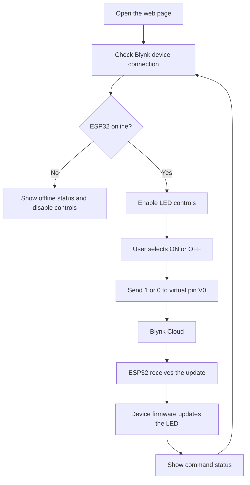

# ESP32 Web LED Control

<p align="center">
  <strong>A simple browser-based control panel for testing an ESP32 LED through Blynk Cloud.</strong>
</p>

<p align="center">
  
  
  
</p>

---

## Overview

**ESP32 Web LED Control** is a small web interface for checking whether a Blynk-connected ESP32 can receive a basic LED ON/OFF command.

The page provides two controls, an ESP32 connection indicator and a status message. It checks the device connection through Blynk Cloud and sends the LED command using virtual pin `V0`.

This is a lightweight learning and hardware-testing project, separate from the Smart Farming dashboard.

## What it does

- Checks whether the ESP32 hardware is connected to Blynk Cloud.
- Refreshes the connection status every five seconds.
- Enables the ON and OFF controls when the hardware is reported online.
- Sends `1` or `0` to Blynk virtual pin `V0`.
- Displays the result of the command or a connection error.

## How it works



## Requirements

- An ESP32 development board.
- A working Wi-Fi connection for the ESP32.
- A Blynk account and a configured Blynk device.
- A Blynk datastream using virtual pin `V0`.
- ESP32 firmware that connects to the same Blynk device and changes the LED state when `V0` changes.
- A browser to open the web page.

The LED pin and electrical connection are defined by the ESP32 firmware, not by this web page.

## Setup

1. Create or open a Blynk device for your ESP32.
2. Configure a virtual pin datastream named `V0` for the LED command.
3. Upload ESP32 firmware that connects to that Blynk device and handles the `V0` updates.
4. Open `index.html` in a browser.
5. Configure authentication using a secure private arrangement before attempting to control the device.
6. Confirm that the page reports the ESP32 as online. The ON and OFF buttons become available only when the connection check succeeds.

## Security

The public version intentionally leaves the Blynk authentication token empty. This means the controls remain unavailable until authentication is configured.

**Do not put a real Blynk token into a publicly hosted HTML or JavaScript file.** Browser-side code is visible to visitors. For a public deployment, use a small authenticated backend or proxy to keep the Blynk token private. Keep any local test credentials out of Git commits.

## Project structure

```text
ESP32-Web-Control/
└── index.html    # Complete page: layout, styling and Blynk control logic
```

## Notes

- This repository is an LED connectivity and control test, not a complete IoT dashboard.
- It does not flash firmware to the ESP32.
- It relies on Blynk Cloud for device status and virtual-pin updates.
- The device must be online and configured with the matching `V0` datastream for the test to work.

## Credits

Created by **Kushagra Gupta**.

A small ESP32 and web-development experiment.

---
